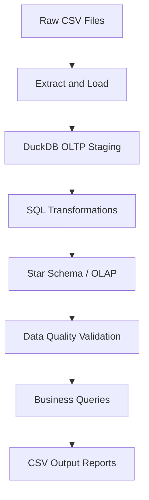

# Data Engineering Take-Home Case Study: Wide World Importers

## 1. Solution Overview

This project builds an end-to-end **Extract, Load, and Transform (ELT) pipeline** for Wide World Importers (WWI). It ingests highly normalized operational (OLTP) data from raw CSV files into a DuckDB database and transforms it into an analytics-ready dimensional model (**Star Schema**) using SQL.

The pipeline includes data quality checks and supports historical tracking through **Slowly Changing Dimensions (SCD Type 2)**.

All pipeline scripts and SQL queries are located in the following directory:

`3_case_study/03_cs_data_engineering_guide/`

## 2. Business Questions, Results & Insights

The pipeline executes analytical queries against the Star Schema to extract business insights. The generated CSV outputs can be found in:

`3_case_study/03_cs_data_engineering_guide/output/`

### Key Insights

1. **Sales & Profit by Fiscal Year/Month**

   Sales remain highly seasonal. Early FY 2013 showed steady growth, with Fiscal Month 3 (January) achieving approximately **$1.3M in sales** and **$890K in profit**. Sales dipped slightly in Month 4 before rebounding in Months 5 and 6, exceeding **$1.6M in sales**.

2. **Top-Performing Products**

   Packaging materials dominate profit margins. **20 mm Double Sided Bubble Wrap** generated approximately **$290K in profit**, while the **Air Cushion Machine (Blue)** was the leading revenue driver, generating approximately **$1.7M in sales**.

3. **Top Customers & Categories**

   **Novelty Shops** is the dominant customer category, led by **Tailspin Toys (Inguadona, MN)**.

4. **Sales by Location**

   Revenue is distributed across several delivery cities, with no single extreme outlier. Cities such as **ID 31685** are among the leading contributors to sales.

5. **Top Salespeople**

   The sales team demonstrates strong competition. **Archer Lamble** leads with approximately **$1.6M in sales**, followed by **Kayla Woodcock** with approximately **$1.1M**.

## 3. Technology Stack & Prerequisites

- **Python 3.11+** — Orchestrates the pipeline and handles data ingestion.
- **DuckDB** — An in-process analytical database used for OLTP staging and OLAP transformations, offering fast analytical queries without requiring a separate database server or Docker.
- **SQL** — Implements transformations, dimensional modeling, and analytical queries.

## 4. Pipeline Execution

To execute the entire pipeline, including extraction, OLTP loading, OLAP transformation, data quality validation, and business queries, follow these steps.

### Step 1: Navigate to the Project Directory

```bash
cd 3_case_study/03_cs_data_engineering_guide
```

### Step 2: Create a Virtual Environment

```bash
python -m venv env
```

### Step 3: Activate the Virtual Environment

**Windows (Command Prompt):**

```bat
env\Scripts\activate
```

**Windows (PowerShell):**

```powershell
.\env\Scripts\Activate.ps1
```

**macOS/Linux:**

```bash
source env/bin/activate
```

### Step 4: Install Dependencies

```bash
pip install -r requirements.txt
```

### Step 5: Run the Pipeline

```bash
python run_pipe.py
```

## 5. Pipeline Architecture

The pipeline follows an ELT architecture, moving raw CSV data through staging, transformation, and validation before generating analytical outputs.



## 6. Data Modeling

The pipeline transforms highly normalized operational data into a dimensional model specifically optimized for fast, analytical workloads.

Key components include:

- **Fact tables** — The core of the model. They store the quantitative, measurable business events (the "metrics"), such as order quantities, sales amounts, and tax rates.
- **Dimension tables** — The context. They provide the descriptive attributes (the "who, what, where, and when"), such as customer names, product categories, and transaction dates, allowing us to filter and group the fact data.
- **Star Schema** — The architecture. A centralized Fact table directly connected to multiple surrounding Dimension tables. This denormalized structure minimizes complex JOINs, drastically speeding up and simplifying business reporting.
- **Slowly Changing Dimensions (SCD Type 2)** — The historical record. Instead of overwriting data when a business attribute changes (like a product's price or brand), SCD Type 2 preserves the full history by "expiring" the old record and inserting a new active version.

## 7. Data Quality

Data quality assertions are embedded directly into the pipeline to guarantee the reliability, accuracy, and consistency of the transformed data.

These automated checks run after the transformations but before any analytical reports are generated. They validate critical constraints, such as ensuring primary keys are not null, checking that business keys are strictly unique, and guaranteeing that fact records successfully resolve to their dimension foreign keys.

## 8. Project Structure

```text
3_case_study/
└── 03_cs_data_engineering_guide/
    ├── output/
    ├── requirements.txt
    ├── run_pipe.py
    └── ...
```

*Note: Update the project structure above to reflect the actual files and directories in your repository.*

## 9. Expected Outputs

After successful execution, the pipeline generates analytical CSV reports in the `output/` directory. These reports contain the results of the business queries used to analyze sales, profitability, product performance, customer categories, delivery locations, and salesperson performance.

## 10. Summary

This project demonstrates the implementation of an end-to-end ELT pipeline using Python, DuckDB, and SQL. It combines data ingestion, dimensional modeling, historical tracking, data quality validation, and business analytics into a reproducible workflow that transforms raw operational data into actionable business insights.
